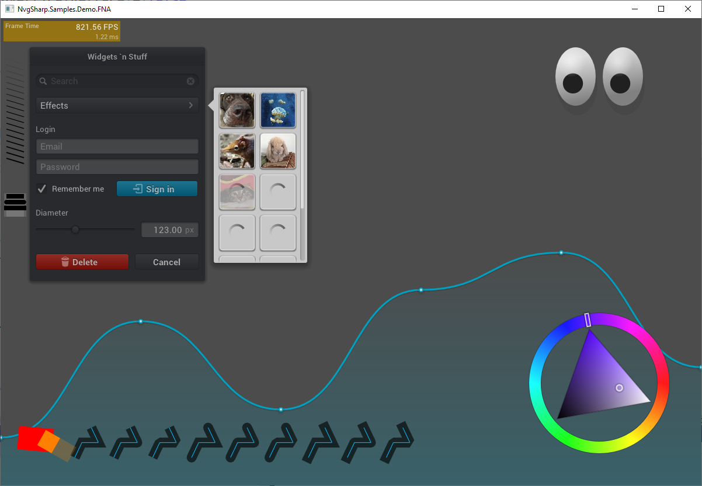

# NvgSharp
 

NvgSharp is 2D vector graphics library in pure C#.

# Usage
[Using NvgSharp in MonoGame or FNA](https://github.com/rds1983/NvgSharp/wiki/Using-NvgSharp-in-MonoGame-or-FNA)

[Using NvgSharp in Generic Game Engine](https://github.com/rds1983/NvgSharp/wiki/Using-NvgSharp-in-Generic-Game-Engine)

[Text Rendering](https://github.com/rds1983/NvgSharp/wiki/Text-Rendering)

## Support
[Discord](https://discord.gg/ZeHxhCY)

## Building From Source Code
1. Clone this repo.
2. Open a solution from the "build" folder.

## Sponsor
If this project is useful for you, you can support the development:
- Boosty: https://boosty.to/rds1983
- Telegram Wallet: https://t.me/rds1983

### Crypto
| Network (Blockchain) | Supported Tokens | Wallet Address |
| :--- | :--- | :--- |
| **TON Network** | Gram (native), USDT (TON) | UQCQy6tFInPvqinE44zHY4R0rYS3niaBikkqiSyGmyoAMwyO |
| **BNB Smart Chain** | BNB (native), USDT (BEP20) | 0x4205d5B12e4edc2D30E97A398A627c83872084E9 |
| **Solana** | SOL (native), USDT (SPL) | GjHtV9mP4eJNmi8p5bwsHtb5WV2zFu3v5VhiZ1bvddGV |
| **TRON** | TRX (native), USDT (TRC-20) | TM2SbB9eRQ99MP6d85a3yJSCWhqeV46crh |
| **Bitcoin** | BTC (native) | bc1qygcxzyhz0m34m9anj27rdydjekkv5ymxa9f927 |

# Screenshot

## Credits
* [nanovg](https://github.com/memononen/nanovg)
* [MonoGame](http://www.monogame.net/)
* [FNA](https://github.com/FNA-XNA/FNA)
* [OpenTK](https://github.com/opentk/opentk)
* [Silk.NET](https://github.com/dotnet/Silk.NET)
* [stb](https://github.com/nothings/stb)
